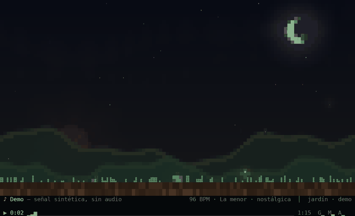
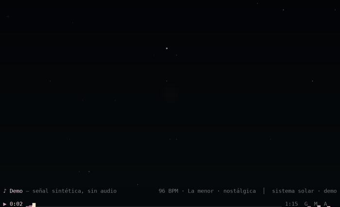
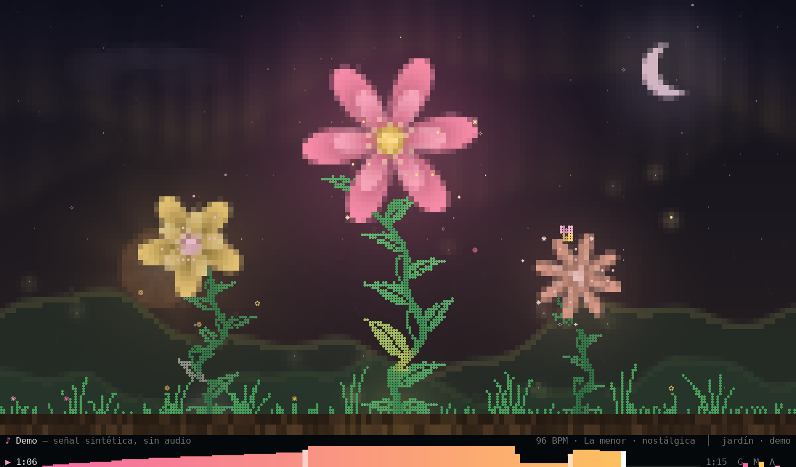
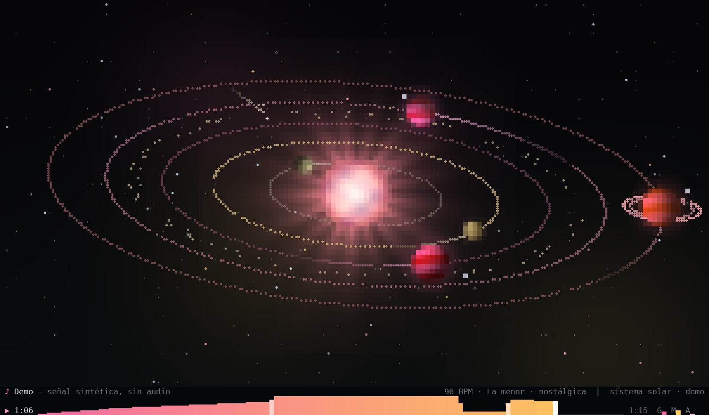
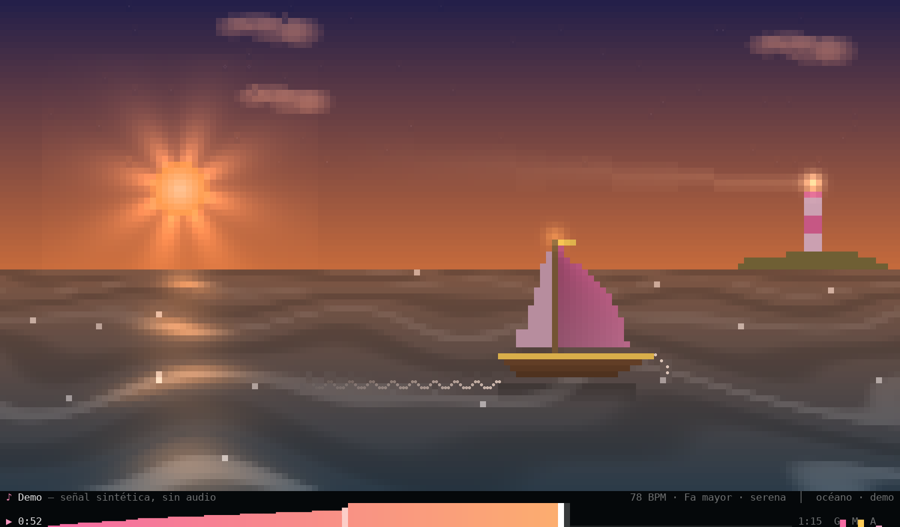
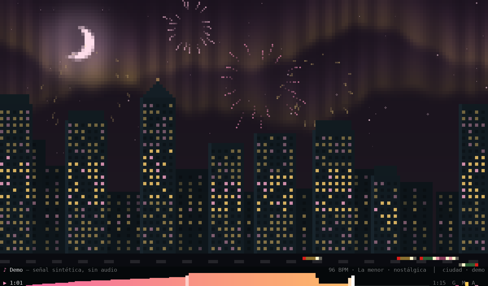
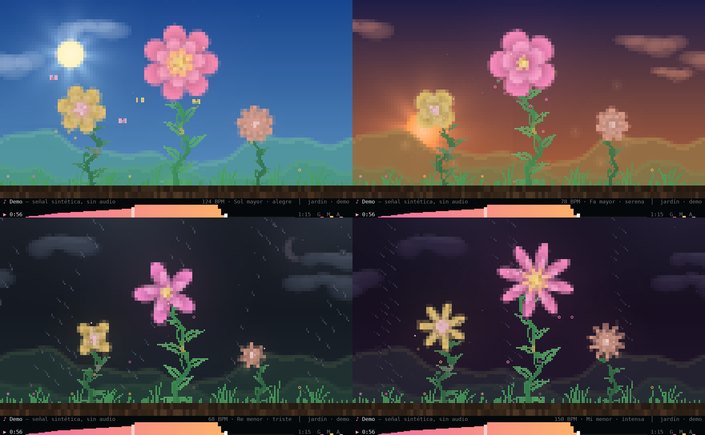
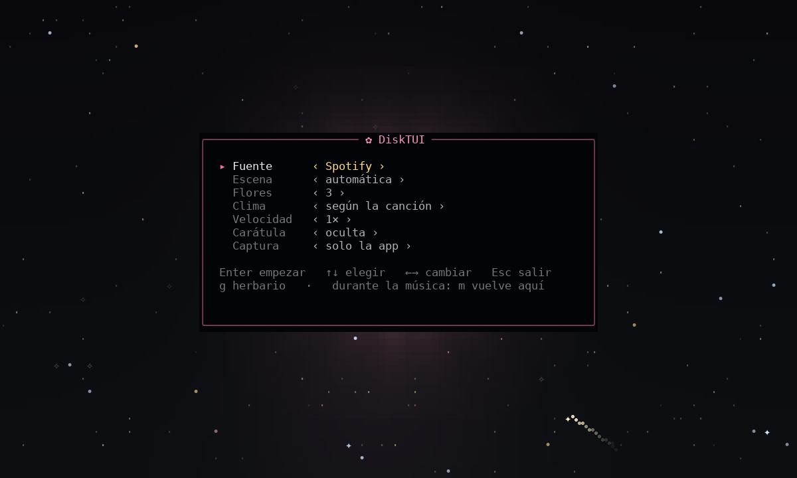
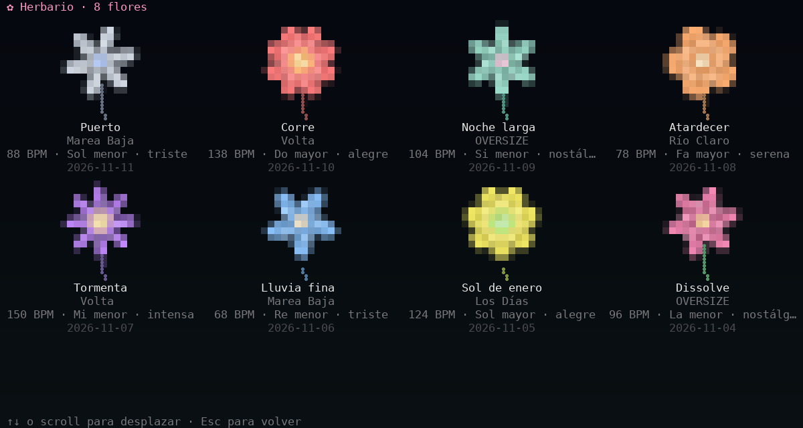
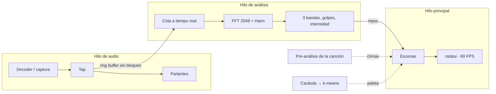

<div align="center">

# 🌸 DiskTUI

**Tu música, creciendo en la terminal.**

Un visualizador de audio para macOS escrito en Rust. Cada canción hace brotar un jardín
o nacer un sistema solar, con los colores de la carátula del disco.





<sub>Una canción completa en 8 segundos. Imágenes generadas desde la salida real del programa (`--demo`).</sub>

</div>

---

## Qué hace

- **La escena la elige la canción** (modo automático), o la fijas tú.
- **Cuatro escenas**, que cambias en vivo con la tecla `e`:
  - 🌱 **Jardín.** Un brote sale de la tierra, crece como enredadera y florece. Dos flores
    más chicas lo acompañan. Alrededor: aurora, luna, cerros, flores silvestres,
    luciérnagas y mariposas.
  - 🪐 **Sistema solar.** Primero aparecen estrellas, después se enciende un sol, después
    nacen entre 4 y 7 planetas al azar, con anillos, lunas y un cinturón de asteroides.
  - ⛵ **Océano.** Un velero cruza el mar durante la canción y llega al faro al final.
    El oleaje sigue a los graves y el cielo se refleja en el agua.
  - 🌆 **Ciudad.** Los edificios se levantan de a uno durante la canción. Las ventanas
    siguen la música y los clímax lanzan fuegos artificiales.
- **Reacciona a tres bandas**: graves, medios y agudos, más bombos y platillos detectados.
- **Entiende el ánimo de la canción** y arma el clima según eso: sol si es alegre,
  atardecer si es serena, noche con luna si es nostálgica, lluvia si es triste, tormenta
  si es intensa.
- **Sigue el pulso**: estima el tempo y predice cada golpe, así la escena se mece al compás.
- **Entiende los clímax**: sabe cuándo entra el coro o cae el drop, y la escena estalla.
- **Una flor única por canción**, guardada en tu **herbario** cuando la escuchas entera.
- **Colores de la carátula**: lee el arte del disco y arma la paleta con él.
- **Barra de reproducción con la forma de la canción**: ves de antemano dónde vienen los
  clímax.
- **Carátula en pantalla**, opcional: tecla `c`, `--caratula` o la fila *Carátula* del menú.
- **Archivos locales, Spotify o Apple Music**: mp3, flac, wav, ogg, m4a, o lo que suene en
  la app.
- **100% local.** Sin APIs ni cuentas. La única llamada de red es bajar la carátula en
  modo Spotify.

<div align="center">


<br><br>


<br><br>

<br>
<sub>El mismo jardín con cuatro ánimos: alegre, serena, triste e intensa.</sub>
</div>

## Instalación

Necesitas macOS, [Rust](https://rustup.rs) 1.89 o superior y una terminal con color de
24 bits (Ghostty, iTerm2, Kitty, WezTerm). Sin eso último cae solo a 256 colores.

Con Homebrew:

```sh
brew tap benyens/disktui https://github.com/benyens/DiskTUI
brew install --HEAD disktui
```

O desde el código:

```sh
git clone https://github.com/benyens/DiskTUI && cd DiskTUI
cargo install --path .
```

La primera compilación tarda un par de minutos. Queda el comando `disktui`:

```sh
disktui
```

Si la terminal no lo encuentra, agrega `~/.cargo/bin` a tu PATH:
`echo 'export PATH="$HOME/.cargo/bin:$PATH"' >> ~/.zshrc` y abre otra terminal.

Para probar sin instalar: `cargo run --release`.

## Uso

`disktui` a secas abre el **menú de inicio**, sobre una vista previa animada:

<div align="center"></div>

- Viene apuntando a **Spotify**: Enter y empieza.
- `↑` `↓` eligen fila, `←` `→` cambian el valor, `Esc` sale.
- Con fuente *Archivo*, escribe la ruta o arrastra el archivo a la terminal.
- Lo elegido se guarda en `~/.config/disktui/config` y vuelve la próxima vez.
- Durante la música, `m` vuelve al menú.
- `g` abre el herbario.

También se puede saltar el menú desde la línea de comandos:

| Comando | Qué hace |
| --- | --- |
| `disktui <archivo>` | Reproduce el archivo y lo visualiza |
| `disktui --spotify` | Visualiza lo que suena en la app de Spotify |
| `disktui --apple-music` | Lo mismo con Apple Music (experimental) |
| `disktui --herbario` | Muestra las flores de las canciones que ya escuchaste |
| `disktui --demo` | Animación con señal sintética, sin audio |
| `disktui --diagnostico` | Prueba el modo Spotify paso a paso y dice qué falla |

| Opción | Efecto |
| --- | --- |
| `--escena <nombre>` | `auto` (por defecto: la elige el ánimo), `jardin`, `sistema`, `oceano` o `ciudad` |
| `--flores <n>` | Flores del jardín, de 1 a 3. Por defecto 3 |
| `--petalos <n>` | Pétalos de la flor principal, de 3 a 12 |
| `--velocidad <x>` | Qué tan rápido crece la escena. `2` = el doble. Por defecto 1 |
| `--mini` | Para un panel chico (tmux): HUD de una línea, una flor, 30 FPS |
| `--caratula` | Muestra la carátula del disco en una esquina |
| `--animo <nombre>` | Fija el clima: `alegre`, `serena`, `nostalgica`, `triste`, `intensa`. Por defecto lo decide la canción |
| `--fps <n>` | Cuadros por segundo. Por defecto 60 |
| `--sin-hud` | Arranca sin el HUD |
| `--dispositivo <nombre>` | Modo Spotify: captura desde esa entrada de audio |
| `--global` | Modo Spotify: captura todo el audio del sistema |

| Tecla | Acción |
| --- | --- |
| `e` | Cambiar de escena: automática, jardín, sistema solar, océano, ciudad |
| `c` | Mostrar u ocultar la carátula |
| `d` | Panel de análisis: qué entendió de la canción. Con el panel abierto, `1`–`5` corrigen el ánimo y `0` lo devuelve a automático |
| `n` / `p` | Canción siguiente / anterior (Spotify y Apple Music) |
| `s` | Guardar una postal PNG en `~/Pictures/DiskTUI` |
| `m` | Volver al menú |
| `espacio` | Pausa |
| `+` / `-` | Volumen |
| `h` | Mostrar u ocultar el HUD |
| `q`, `Esc`, `Ctrl-C` | Salir |

## HUD

```
 ♪ Título — Artista                                  jardín · archivo · vol 80%
              ▂▄▆███████▇▅▃                 ▃▅▇██████████
 ▶ 1:23 ▁▁▁▂▃▅██████████████▇▅▃▂▁▁▁▁▁▁▁▂▃▅▇██████████████▇▅▂▁ 3:45  G▆ M▄ A▂
```

- **Barra de reproducción.** Dibuja la intensidad de toda la canción como una onda. Lo ya
  escuchado va en los colores de la carátula, la posición actual en blanco y lo que falta
  en gris. Los clímax se marcan: más claros si ya pasaron, en color de acento si vienen.
- **Modo archivo:** la onda completa aparece al abrir, porque la canción se pre-analiza.
- **Spotify y demo:** la onda se va dibujando a medida que suena.
- **`G` `M` `A`:** medidores de graves, medios y agudos.
- En terminales de menos de 16 filas queda una sola línea. `h` lo oculta entero.

## Qué mueve cada cosa

| Señal | 🌱 Jardín | 🪐 Sistema solar |
| --- | --- | --- |
| Avance de la canción | Altura del tallo; llega arriba pasada la mitad | Estrellas (0–20%), sol (5–20%), planetas (20–68%) |
| Graves, 20–250 Hz | Aceleran el crecimiento, mecen el tallo, ondas en la tierra | El sol late |
| Bombo | Brota una hoja, sube un pulso de luz | Una onda sale del sol e ilumina las órbitas |
| Medios, 250–4000 Hz | Abren la flor y la hacen girar | Los planetas giran más rápido |
| Agudos, 4–20 kHz | Tamaño de la flor, polen | Las estrellas titilan |
| Platillo | Chispas, destella una luciérnaga | Nace una estrella, otra destella, a veces cruza un cometa |
| Volumen | Resplandor de la flor, halo de la luna | Corona del sol |
| Intensidad | Aurora en el cielo, brillo del fondo, polen, luciérnagas | Nebulosas, largo de las estelas, velocidad |
| **Clímax** | La flor se abre de golpe y suelta pétalos y chispas | Onda de choque y lluvia de cometas |
| Carátula | Pétalos, pistilo y tallo | Sol, planetas y nebulosas |
| Pulso | Vaivén de los tallos, latido de las flores | Latido del sol |
| Ánimo | Cielo, clima y velocidad de crecimiento | Espacio frío o cálido, velocidad de las órbitas; lluvia de estrellas si es triste, erupciones del sol si es intensa |
| Cambio de sección | Ráfaga de viento | — |

### ⛵ Océano

Un velero zarpa al empezar la canción y llega al faro cuando termina.

| Señal | Qué hace |
| --- | --- |
| Avance de la canción | El velero cruza el mar; las velas se despliegan al zarpar |
| Graves | Levantan el oleaje y mecen el velero |
| Bombo | Espuma en la proa |
| Agudos | Destellos en el agua |
| Pulso | Hincha las velas, hace latir el faro y el farol del mástil |
| **Clímax** | Salta un cardumen de peces |
| Cambio de sección | Salta un pez |
| Ánimo | El mismo clima del jardín: sol, atardecer, luna, lluvia o tormenta, con su reflejo en el agua. Con tormenta el mar se pica |
| Carátula | Velas, franjas del faro y banderín |

### 🌆 Ciudad

| Señal | Qué hace |
| --- | --- |
| Avance de la canción | Los edificios suben de a uno; la ciudad queda completa pasada la mitad |
| Graves, medios, agudos | Brillo de las ventanas de los pisos bajos, medios y altos |
| Intensidad | Cuántas ventanas hay encendidas |
| Platillo | Ventanas que se prenden y apagan |
| Pulso | Balizas rojas de las antenas, latido de las ventanas |
| Volumen y tempo | Velocidad del tránsito |
| **Clímax** | Fuegos artificiales |
| Cambio de sección | Un fuego artificial suelto |
| Ánimo | El mismo clima del jardín; con lluvia la calle se moja |
| Canción nueva | La ciudad se hunde y se arma otra distinta |

## Cómo entiende la canción

Todo es procesamiento de señal clásico, sin modelos entrenados y en tiempo real. Ver
[`src/features.rs`](src/features.rs) y [`src/mood.rs`](src/mood.rs).

| Qué | Cómo | Para qué |
| --- | --- | --- |
| **Pulso** | Flujo espectral 100 veces por segundo, autocorrelación para el tempo y un peine para la fase. Los graves pesan el triple al fijar la fase, para caer en el bombo y no en el contratiempo | Predice cada golpe: los tallos se mecen al compás y el sol late con él |
| **Tonalidad** | Croma de 12 notas desde una FFT de 8192, comparado con los perfiles de Krumhansl-Kessler de las 24 tonalidades | Mayor o menor |
| **Brillo** | Centroide espectral | Timbre opaco o brillante |
| **Densidad** | Ataques por segundo | Cuánto pasa en la canción |
| **Estéreo** | Energía de cada canal | La flor izquierda oye más el canal izquierdo; la derecha, el derecho |

Con eso se ubica la canción en un plano de dos ejes: **valencia** (triste ↔ alegre; pesan el
modo y el brillo) y **activación** (calmada ↔ enérgica; pesan el tempo y la densidad). Cinco
climas marcan puntos de ese plano y la escena se mezcla entre ellos de forma continua:

| Ánimo | Canción | Clima | Crece |
| --- | --- | --- | --- |
| alegre | mayor, rápida, brillante | día soleado, nubes blancas, mariposas | más rápido |
| serena | mayor, lenta | atardecer naranja, sol bajo | normal |
| nostálgica | intermedia | noche con luna, estrellas y aurora, luciérnagas | normal |
| triste | menor, lenta, opaca | cielo gris, lluvia | más lento |
| intensa | menor, rápida | tormenta, viento, relámpagos en los clímax | más rápido |

En modo archivo el ánimo se conoce al abrir, porque la canción se pre-analiza entera. En
Spotify se va afinando durante los primeros 20 segundos y el clima cambia de a poco. El HUD
muestra lo entendido: `96 BPM · La menor · nostálgica`.

Es una heurística: acierta el carácter general de una canción, no sus matices. Si no te
convence para un tema, `--animo` o la fila *Clima* del menú lo fijan a mano.

### Escena automática

Con la escena en *automática*, cada canción elige también dónde ocurre:

| Ánimo | Escena |
| --- | --- |
| alegre | 🌸 jardín al sol |
| serena | ⛵ océano al atardecer |
| nostálgica | 🪐 sistema solar |
| triste | ⛵ océano con lluvia |
| intensa | 🌆 ciudad con tormenta |

La elección se hace una vez por canción, cuando el análisis ya es fiable: de inmediato en
modo archivo, a los ~20 segundos en Spotify, con un fundido corto. La tecla `e` recorre
automática → jardín → sistema solar → océano → ciudad.

### Cuando se equivoca

La tecla `d` abre un panel con lo que DiskTUI midió: valencia, activación, tempo, tonalidad
y la confianza de cada uno. Con el panel abierto, `1` a `5` fijan el ánimo de **esa
canción** y `0` lo devuelve a automático. La corrección se recuerda para la próxima vez que
suene.

Las correcciones quedan en `~/.local/share/disktui/animos.tsv`, junto a lo que el análisis
había medido. Ese archivo es la base para calibrar la heurística con música real.

## Flor única y herbario

Cada canción da su propia flor. El **tempo** fija el número de pétalos (de 5 a 9), el
**modo** su forma (redondos en mayor, puntiagudos en menor), la **energía** el tamaño y la
cantidad de capas, y la **tónica** corre un poco el tono del color de la carátula. La misma
canción da siempre la misma flor.

Cuando escuchas al menos el 60% de una canción, su flor queda guardada. `disktui --herbario`
(o `g` en el menú) muestra la colección:

<div align="center"></div>

La tecla `s` guarda la escena del momento como PNG en `~/Pictures/DiskTUI`.

## Cómo detecta los clímax

Las tres bandas se normalizan cuadro a cuadro, así que por sí solas no distinguen un verso
de un coro. Para eso hay una señal aparte, la **intensidad**, que mide el volumen real en
decibeles a escala de canción.

- **Modo archivo: mira el futuro.** Al abrir, un hilo decodifica la canción completa (menos
  de un segundo), mide el volumen cada 0,25 s y lo ubica entre los percentiles 15 y 92 de
  la propia canción. Un clímax es un pasaje que sube sobre 0,72, se sostiene al menos 5 s y
  viene de uno más tranquilo. El instante exacto se afina buscando el mayor salto de
  volumen alrededor. Ver [`src/structure.rs`](src/structure.rs).
- **Modo Spotify: tiempo real.** No hay futuro que mirar. Se comparan dos promedios del
  volumen, uno rápido (~1 s) y uno lento (~18 s). Cuando el rápido salta más de 3 dB sobre
  el lento, cerca del máximo visto hasta ahora, es un clímax. Ver `Dynamics` en
  [`src/analysis.rs`](src/analysis.rs).

## Modo Spotify

```sh
disktui --spotify
```

Abre la app de escritorio de Spotify y pon música antes de lanzarlo.

- **Audio.** Spotify no entrega muestras de audio a terceros, así que se captura lo que
  suena. Al arrancar se prueban tres métodos, un segundo cada uno, y queda el primero con
  señal: dos variantes de tap de Core Audio sobre los procesos de Spotify (solo esa app) y,
  si ninguna sirve, todo el audio del sistema.
- **Título, posición y carátula.** Se leen por AppleScript desde la app. Sin Web API, sin
  OAuth, sin credenciales.
- **Cambio de canción.** La escena se deshace y nace otra con la paleta de la nueva
  carátula: las flores se marchitan, el sistema solar colapsa hacia el sol.

macOS pide dos permisos la primera vez, a nombre de tu terminal: controlar Spotify
(Automatización) y grabar el audio del sistema.

<details>
<summary><b>Si algo no funciona</b></summary>

Con música sonando en Spotify:

```sh
disktui --diagnostico
```

Tarda unos 10 segundos y deja el reporte en `disktui-diagnostico.txt`. Qué hacer según el
resultado:

1. **El título muestra `AppleScript: ...` o `[1]` da ERROR.** Falta el permiso de
   Automatización: Ajustes del Sistema → Privacidad y seguridad → Automatización → tu
   terminal → Spotify. Sin esto no hay título, carátula ni cambio de canción.
2. **`[3]` dice SILENCIO en todos.** Falta el permiso de audio: Ajustes del Sistema →
   Privacidad y seguridad → Grabación de pantalla y audio del sistema → sección de solo
   audio del sistema. Agrega tu terminal con `+`, actívala, ciérrala por completo y
   reábrela.
3. **Solo "audio global" da OK.** Funciona, pero captura todo lo que suena en el Mac.
4. **Nada da OK con los permisos puestos.** Instala
   [BlackHole](https://github.com/ExistentialAudio/BlackHole), crea un dispositivo de
   salida múltiple (parlantes + BlackHole) en Configuración de Audio MIDI y usa
   `disktui --spotify --dispositivo BlackHole`.

`--global` se salta los taps por app. `cargo build --no-default-features` compila sin ellos.

</details>

## Arquitectura



- **Tap.** Un adaptador sobre el `Source` de rodio. Deja pasar el audio intacto y copia una
  mezcla mono a un ring buffer. Rodio pide las muestras justo antes de reproducirlas, así
  que el análisis queda sincronizado con lo que suena.
- **Hilo de análisis.** Consume el ring a ritmo de tiempo real aunque el audio llegue en
  bloques. Aplica ventana de Hann, FFT real y suma la energía por banda.
- **Normalización adaptativa.** Cada banda se divide por su pico reciente, que decae en
  unos 8 segundos. Así una canción baja y una fuerte se ven parecido, y los agudos, que
  traen mucha menos energía que los graves, también mueven la escena.
- **Render en tres capas** sobre la misma grilla: píxeles de media celda (`▀`, color
  completo) para fondo, resplandor, pétalos, sol y planetas; Braille para tallos, hojas,
  órbitas y cometas; glifos (`• ✦ ✧ ❀ ✿ ❁ ░▒▓█`) para polen, estrellas y tierra.
- **Flor.** Rosa polar por capas, `r(θ) = |cos(n·θ/2)|^p`. El exponente baja al abrirse.
  Las semillas del centro siguen una espiral de Fibonacci.
- **Planetas.** Esferas sombreadas según la dirección del sol. Giran según Kepler: los de
  adentro, más rápido.

<details>
<summary><b>Mapa del código</b></summary>

| Archivo | Contenido |
| --- | --- |
| `src/main.rs` | Argumentos, bucle principal, teclado |
| `src/analysis.rs` | FFT, bandas, golpes, intensidad en tiempo real, hilo de análisis |
| `src/features.rs` | Pulso, tonalidad, brillo, densidad y ánimo |
| `src/mood.rs` | Del ánimo al clima |
| `src/structure.rs` | Pre-análisis del archivo: intensidad, clímax, secciones y perfil de toda la canción |
| `src/audio.rs` | Modo archivo: rodio y el tap |
| `src/spotify.rs` | Spotify y Apple Music: AppleScript y carátula |
| `src/capture.rs` | Captura de audio con cpal y orden de respaldos |
| `src/tap_macos.rs` | Tap de Core Audio por proceso |
| `src/diagnose.rs` | Diagnóstico del modo Spotify |
| `src/demo.rs` | Señal sintética |
| `src/session.rs` | Interfaz común de las fuentes de audio |
| `src/scene.rs` | Interfaz común de las escenas |
| `src/garden.rs`, `src/plant.rs`, `src/render.rs` | Escena jardín |
| `src/scenery.rs` | Ambiente del jardín: aurora, luna, cerros, flores silvestres, luciérnagas, mariposas |
| `src/menu.rs` | Menú de inicio y configuración guardada |
| `src/ocean.rs` | Escena océano: mar, velero y faro |
| `src/city.rs` | Escena ciudad: edificios, ventanas y fuegos artificiales |
| `src/tuning.rs` | Correcciones de ánimo por canción |
| `src/herbarium.rs` | Herbario: guardado y vista de la colección |
| `src/postcard.rs` | Postal PNG |
| `src/cosmos.rs` | Escena sistema solar |
| `src/canvas.rs` | Lienzo de tres capas |
| `src/palette.rs` | Paleta desde la carátula |
| `src/meta.rs` | Etiquetas y carátula embebida |
| `src/ui.rs` | HUD y barra de reproducción |
| `src/color.rs` | Color RGB, HSL, respaldo a 256 colores |

</details>

## Tests

```sh
cargo test
```

Cubren la FFT por banda, bombos, clímax (en tiempo real y pre-analizado), el crecimiento del
jardín, el orden de aparición del sistema solar, la paleta y el lienzo. Los tests con
archivos de audio reales solo corren si defines `DISKTUI_TEST_MEDIA`; sin ella se saltan.

## Estado

- **Demo, render y modo Spotify:** probados en macOS con Ghostty.
- **Modo archivo:** cubierto por tests con archivos reales (decodificación, bombos, clímax,
  tempo, carátula) y por una prueba de la cadena completa en tiempo real.
- **Pulso, tonalidad y ánimo:** probados con audio sintético de tempo y acordes conocidos
  (tempo dentro de ±2 BPM, golpes a menos de 60 ms). Con música real pueden fallar, sobre
  todo el ánimo; para eso está `--animo`.
- **Apple Music y la fórmula de Homebrew:** escritos sin poder ejecutarlos. Experimentales.

## Ideas

- Más escenas: fogata, bosque.
- Binario precompilado en los releases, para instalar sin compilar.
- Seek y listas de reproducción en modo archivo.
